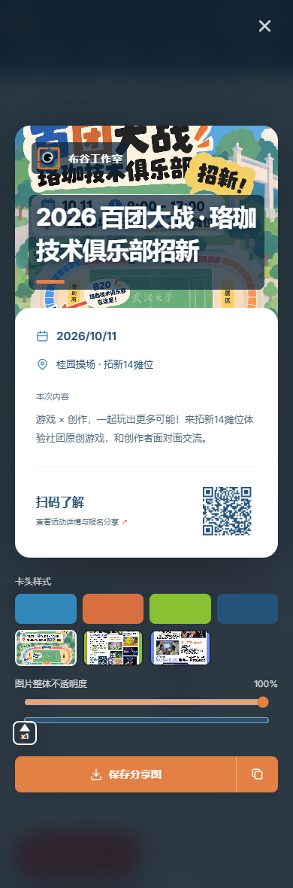
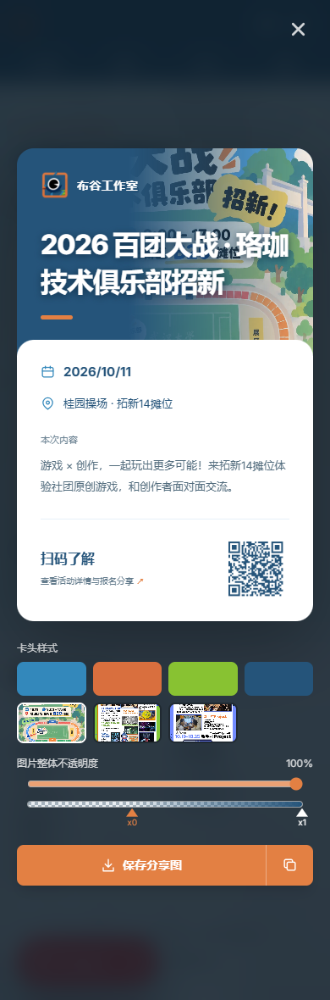
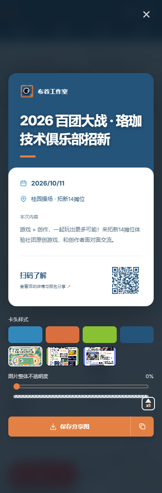

# 分享卡头：完整图片到完整遮罩

图片卡头现在能到达两个明确端点：整体不透明度 100%、`x0` 和 `x1` 都在 0 时显示完整图片；整体不透明度 0%，或两个三角柄都在 100 时显示完整遮罩色。中间位置仍可拖动形成渐变。移除了盖在整张图片上的固定暗色层，完整图片端点的文字使用局部底色保持可读。

| 状态 | 桌面 | 手机 |
| --- | --- | --- |
| 完整图片 |  |  |
| 渐变 |  |  |
| 完整遮罩 |  |  |

验证：两项分享相关测试文件共 6 项通过，TypeScript 检查通过；Edge 浏览器桌面和手机宽度分别操作两个端点，并成功导出两个端点的 PNG，无页面异常。
