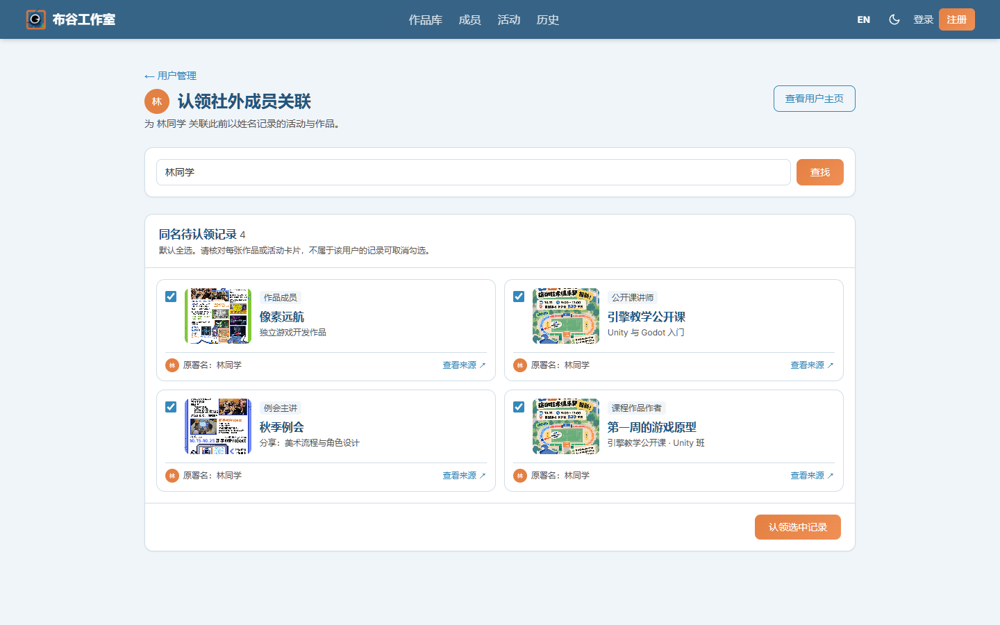
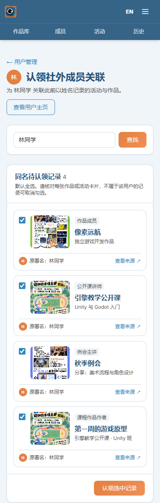

# 社外成员关联认领

管理员可从用户管理列表、站内用户主页和成员主页进入认领页面。页面按完整原署名查找未关联记录，展示作品、公开课、例会及课程作品卡片。搜索结果默认全选，管理员可逐条核对来源并取消勾选。

认领保留原署名；更新用户关联时检查重复和并发变更，并记录管理员操作。公开课讲师新增注册用户关联，后续编辑活动时继续保留该关联。

## 验收截图

截图使用开发预览中的示例数据。

## 验证

- `prisma validate`、Prisma Client 生成与 TypeScript 类型检查通过。
- 公开课资料相关单元测试 5 项通过。
- 桌面和手机预览均显示 4 张来源卡片，默认全选，取消一项后选中数为 3。

数据库迁移随代码推送，部署环境需要执行迁移后才能使用公开课讲师认领。
